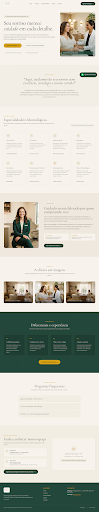

# 🦷 Con Te Odontologia Especializada — Landing Page

> Website institucional e landing page editorial de alta fidelidade desenvolvido com o design system do **Google Stitch** e refinado para web moderna.



---

## 🌟 Sobre o Projeto

A **Con Te Odontologia Especializada** é uma clínica odontológica localizada em **Mauá — SP**, com foco em odontologia humanizada, reabilitação oral de alta precisão, estética do sorriso, ortodontia e acolhimento clínico que transcende o modelo impessoal e asséptico tradicional.

### Destaques Técnicos:
- **HTML5 Semântico** estruturado com acessibilidade (WCAG AAA)
- **Tailwind CSS** com sistema de cores e espaçamento calibrado
- **Tipografia Editorial:** Contrastes entre a elegância atemporal (*Cormorant Garamond* / *Newsreader*) e a clareza contemporânea (*Manrope* / *Plus Jakarta Sans*)
- **Design System do Stitch:** Filosofia visual calorosa, tonal stacking em marfim e bege quente, verde profundo e acentos em ouro metálico
- **Assets 100% locais e preservados:** Logotipo oficial, fotografias de acolhimento e prévias integradas

---

## 📁 Estrutura de Arquivos

```
conte-odontologia/
├── index.html                     # Estrutura completa, layout e lógica da landing page
├── DESIGN.md                      # Especificação completa do Design System e tokens
├── README.md                      # Documentação do projeto
└── assets/
    └── images/
        ├── logo.png               # Logotipo oficial da Con Te Odontologia
        ├── hero-care.jpg          # Fotografia de atendimento humanizado (Hero)
        ├── dra-glauce.jpg         # Retrato de acolhimento profissional
        ├── clinic-environment.jpg # Fotografia do ambiente e instalações
        ├── page-preview.png       # Screenshot completo da interface gerada
        └── reference-image.png    # Imagem de referência visual do projeto
```

---

## 🎨 Design System

Consulte o arquivo [`DESIGN.md`](DESIGN.md) para a especificação completa de tokens:
* **Fundo Marfim Quente:** `#F7F3EC`
* **Verde Profundo Institucional:** `#23483B`
* **Dourado Nobre:** `#D4A017`
* **Bege Quente:** `#D8C8B2`
* **Texto e Contraste:** `#000000`

---

## 🚀 Como Executar Localmente

O projeto é estático e totalmente independente. Você pode abri-lo diretamente no navegador ou rodar com qualquer servidor local:

### Opção 1: Servidor Python
```bash
cd c:\Git\lula\conte-odontologia
python -m http.server 8082
```
Acesse: **[http://localhost:8082](http://localhost:8082)**

### Opção 2: Abrir diretamente
Basta dar um duplo clique no arquivo [`index.html`](index.html) para visualizá-lo em qualquer navegador moderno.

---

## 🔗 Referência do Stitch

- **Projeto Stitch:** `Con Te Odontologia Landing Page`
- **Project ID:** `15963823647501673542`
- **Screen ID:** `08d5868d7864439190259468421ef75d` (*Con Te Odontologia Especializada - Landing Page*)
